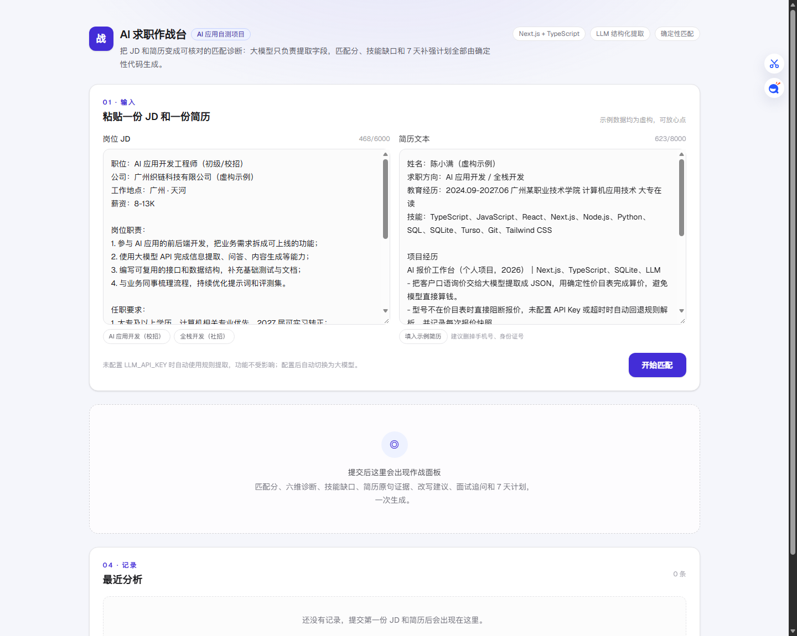
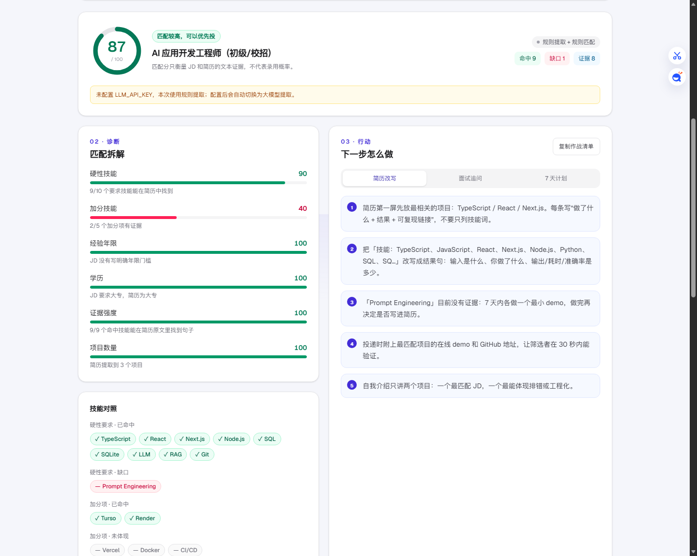

# AI 求职作战台

把一份 JD 和一份简历，变成一张可核对的求职作战面板：**匹配分、六维诊断、技能缺口、简历原句证据、改写建议、面试追问、7 天补强计划**。

> 这是一个 AI 应用自测项目。示例 JD、公司和简历均为虚构，不连接任何招聘平台。

## 界面

| 输入 JD 和简历 | 匹配诊断与行动建议 |
| --- | --- |
|  |  |

## 为什么做

求职时最常见的问题不是“不会”，而是**不知道自己缺什么**：

- 看到 JD 觉得“好像都能投”，投完没有回音；
- 简历里写满技能词，但面试官一问项目就答不上来；
- 想补技能，却不知道先补哪一个、补到什么程度。

这个项目把 JD 和简历放在一起做文本对照：命中的技能必须能在简历原文里找到句子；找不到的，直接列为缺口。**匹配分只衡量文本证据，不代表录用概率。**

## 怎么工作

```text
JD + 简历
   │
   ├─ 大模型（可选）：只做结构化提取
   │     └─ 失败 / 无 Key → 自动回退规则提取
   │
   ├─ 回查原文：模型提取的技能必须能在原文中找到，否则丢弃
   │
   ├─ 确定性匹配：技能覆盖 / 年限 / 学历 / 证据 / 项目数
   │
   ├─ 规则生成：改写建议 / 面试追问 / 7 天计划
   │
   └─ SQLite / Turso 保存分析快照
```

核心取舍：

1. **模型不参与打分。** 分数组件全部是 `lib/match.ts` 里的确定性代码，同一输入永远同一分数。
2. **技能必须回查原文。** 模型说简历会 Rust，但简历里没有，就不算命中。
3. **没有 API Key 也能用。** 规则提取覆盖常见 JD 版式，演示和 CI 都不依赖模型。
4. **建议不编经历。** 生成的改写建议只引用简历原句；没做过的技能，提示先做 demo，而不是直接写“精通”。

## 功能

- **JD 解析**：岗位、公司、地点、学历、年限、职责、硬性技能、加分项
- **简历解析**：技能、项目、教育、可核对年限、原句证据
- **六维诊断**：硬性技能 40%、加分技能 15%、经验 15%、学历 10%、证据强度 10%、项目数量 10%
- **缺口清单**：缺哪个技能、年限差多少、学历是否低于要求
- **简历改写建议**：把已有证据改成“动作 + 技术 + 结果”的句子
- **面试追问**：按命中技能和缺口生成问题、追问原因、回答提示
- **7 天计划**：每天一个任务和一个可验收产出
- **历史快照**：SQLite 本地 / Turso 远程，刷新不丢

## 快速开始

```bash
npm install
cp .env.example .env.local   # Windows: copy .env.example .env.local
npm run dev
```

打开 <http://localhost:3000>，页面已经填好虚构示例，直接点“开始匹配”。

没有配置 `LLM_API_KEY` 时会走规则提取，接口会明确返回当前模式，功能不受影响。

## 环境变量

| 变量 | 必填 | 说明 |
| --- | --- | --- |
| `LLM_API_KEY` | 否 | OpenAI 兼容接口的 Key；不配则走规则提取 |
| `LLM_BASE_URL` | 否 | 默认 `https://api.deepseek.com/v1` |
| `LLM_MODEL` | 否 | 默认 `deepseek-chat` |
| `TURSO_DATABASE_URL` | 否 | 配置后使用 Turso，不配则用本地 SQLite |
| `TURSO_AUTH_TOKEN` | 否 | Turso 访问令牌 |
| `JOB_DB_DIR` | 否 | 本地数据库目录，默认 `.data` |
| `USE_RULE_EXTRACTOR` | 否 | 设为 `1` 时强制规则提取，方便排查 |

> `.env.local` 已在 `.gitignore` 中，不要把 Key 提交到仓库。

## API

### `POST /api/analyze`

```json
{
  "jd": "岗位描述……",
  "resume": "简历文本……",
  "mock": true
}
```

`mock` 可选，传 `true` 强制规则提取，冒烟测试用。返回：

```json
{
  "id": 1,
  "mode": "rule",
  "note": "当前为规则提取模式……",
  "job": { "title": "……", "mustSkills": ["……"] },
  "resume": { "skills": ["……"], "projects": [] },
  "result": {
    "score": 79,
    "dimensions": [],
    "matchedMust": [],
    "missingMust": [],
    "gaps": [],
    "risks": [],
    "evidence": []
  },
  "generated": { "bullets": [], "questions": [], "plan": [] }
}
```

限制：JD 最多 6000 字，简历最多 8000 字。

### `GET /api/analyses`

返回最近 10 条分析快照（不含原始 JD / 简历全文）。

## 评分口径

| 维度 | 权重 | 怎么算 |
| --- | --- | --- |
| 硬性技能 | 40% | 简历技能命中数 / JD 任职要求技能数 |
| 加分技能 | 15% | 命中数 / 加分项技能数；JD 没写加分项时给 70 |
| 经验年限 | 15% | JD 年限不是硬门槛时不扣分；无年限证据给 25 |
| 学历 | 10% | 达到要求 100；低一档 45；无学历信息 45 |
| 证据强度 | 10% | 命中技能中能在简历原文找到句子的比例 |
| 项目数量 | 10% | 1 个 40 分，2 个 70 分，3 个及以上 100 分 |

年限、学历、地点只信规则提取，**不采用模型推断的数字**，避免“2027 届”被误读成“7 年经验”。

## 测试

```bash
# 终端 1
npm run dev

# 终端 2
npm run smoke
```

冒烟测试覆盖：高匹配、低匹配、参数校验、确定性（同输入同分数）、历史记录。CI 在 Node 22 上跑 lint + build + smoke。

## 部署到 Render

仓库自带 `render.yaml`：

1. Render → New → Web Service，选择本仓库；
2. Build Command：`npm install && npm run build`；
3. Start Command：`npm start -- -p $PORT`；
4. 可选：配置 `LLM_API_KEY`、`TURSO_DATABASE_URL`、`TURSO_AUTH_TOKEN`。

Render 免费实例闲置会休眠，首次打开约 30–60 秒。数据默认写本地 `.data`，免费实例重启会丢；要持久化就配 Turso。

## 边界

- 技能词典覆盖常见 Web / AI / 业务工具，冷门技能可能识别不到；
- 中文 JD 版式千差万别，规则提取不保证 100% 准确，模型模式也需要回查；
- 匹配分是文本证据分，不是面试通过率，更不是录用承诺；
- 示例数据全部虚构，请勿把真实身份证号、手机号等敏感信息粘进公开演示站。

## 目录

```text
app/
  api/analyze/route.ts   分析接口：提取 → 匹配 → 生成 → 存档
  api/analyses/route.ts  历史记录
  page.tsx               作战面板
lib/
  extract.ts             规则提取 + 模型结果回查合并
  llm.ts                 OpenAI 兼容 JSON 提取
  skills.ts              技能词典与文本匹配
  match.ts               确定性评分、缺口、证据
  advice.ts              改写建议 / 面试追问 / 7 天计划
  db.ts                  SQLite / Turso 快照
scripts/smoke.mjs        接口冒烟测试
```
